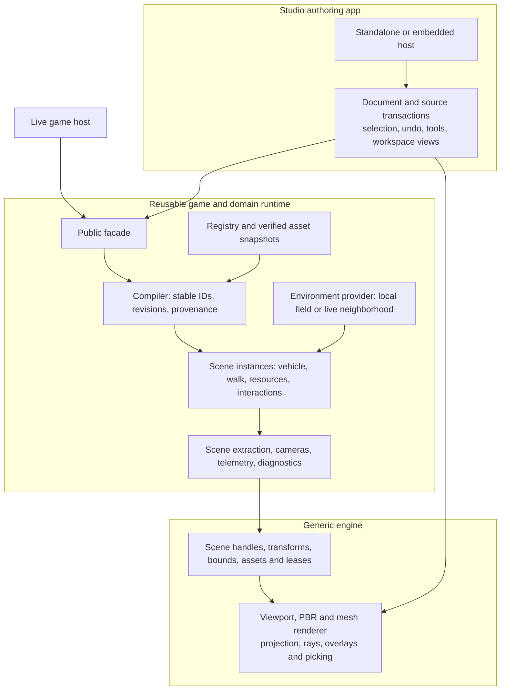

# Make Studio share the complete runtime

> Historical audit and proposal. The owner subsequently required an isolated local copy of the real simulation, with no copied physics integrator. The implemented rebuild follows that decision; see [Studio on the shared engine](../studio-shared-engine.md) for current behavior and validation. Recommendations below describe the earlier audit snapshot.

Ship Studio already shares its engine host and substantial primitives with live flight; **the duplication sits below substantially converged entrypoints, in scene construction, rendering representation and simulation orchestration**. DESIGN/WALK/BALANCE/DRIVE and catalogue cards use a shared CPU projector, while live hulls and equipment use resident PBR rendering. Both flight paths call shared control helpers, but assemble different bodies and execute different resource, environment and contact pipelines. The recommended destination is a small editable document graph, a reusable game/domain compiler and runtime, and a generic engine scene/viewport service. Reach it incrementally, with explicit deletion gates; replacing Studio with today's live tick would discard useful fan, battery and spring-gear experiments. “100% shared” means no alternative implementations of these promoted behaviors, **not identical optional features or sandbox policies**.

**Evidence boundary:** audit snapshot **`31f6854326e1a8e78f71cab47c9ccaee7b22379e`** (`31f68543`). All local source anchors below refer to that commit, even when working files later advance; recover them with `git show 31f6854326e1a8e78f71cab47c9ccaee7b22379e:<path>`. Later main `b0d0da15`, including the reported registry, WALK diagnostics, basis-document and 50-test changes, was **not reaudited**. This report synthesizes all four [research notes](<../research_notes/Studio shared engine architecture/>), the earlier [controls](../studio-shared-controls.md) and [installed-model](../studio-installed-models.md) reports, and the [prior WALK investigation](<../research_notes/Studio shared engine architecture/prior-walk-investigation.md>). No implementation, builds, tests or new benchmarks were performed. Architectural contracts and acceptance gates below are proposals.

## Shared helpers did not establish shared behavior

Standalone `freefall-studio` and `freefall --studio` already converge on `game::studio` and `StudioOnly`; embedded shipyard calls the same Interior draw path. `input_with` already separates much editor input from `App`. The shell is therefore an asset to preserve, not the architectural defect. The separate observer “studio” already uses the live hull renderer under studio lighting, but it is not Ship Studio Interior. ([Entrypoints](../../crates/game/src/lib.rs#L1733), [embedded dispatch](../../crates/game/src/shipyard.rs#L233), [input seam](../../crates/game/src/interior.rs#L6581), [observer](../../crates/game/src/scene.rs#L179).)

The earlier changes consolidated exactly the scopes they documented: input sampling, spatial manual bindings, allocation/angular helpers, asset preparation, and the projector used across Studio modes. Walker and deck construction are also shared. Those achievements do not impose a common document compiler, instance identity, vehicle tick or viewport contract. Their tests could establish helper behavior and Studio consistency without proving complete live-runtime parity. This explains the current outcome without inventing development history or attributing blame.

Rendering illustrates the distinction. `Visual` retains both a PBR model and CPU faces; the latter preserve base factors and alpha flags but omit sampled textures and the PBR material channels. Studio transforms, lights, clips and projects triangles each frame. Live PBR retains GPU geometry, though it still performs instance submission and resource bookkeeping. **Current PBR is not a drop-in replacement:** its blend drawing is not depth-sorted, and its shadow pass cannot sample masked texture alpha. Existing canvas opaque/mask depth, blend ordering, perspective interpolation and fresh-camera depth behavior must remain intact until the replacement passes equivalent gates. The matrix below identifies the exact call sites.

The same distinction holds for simulation. Studio clamps frame time and divides it into four steps, realizes fuel/power-limited forces, then integrates torque and contacts. Live orchestration advances controller/orientation and translational physics differently, including different final-fuel treatment. Studio aggregates experimental batteries/fans and spring legs; live has different fit/device, heat and landing rules. Neither implementation should be declared universally correct simply because it is older or called “live.” Promote the richer experiments into common domain systems and resolve their numerical policies explicitly.

## One compiler and three layers make the small app possible

The proposed dependency boundary keeps Freefall semantics outside the generic renderer. A typed object table is sufficient initially; an ECS conversion is not a prerequisite. Both hosts use one public domain facade, tentatively `freefall_runtime`, which owns compilation, instantiation, tick orchestration, scene extraction and presentation data. Its implementation uses existing domain crates and generic engine services; neither it nor the engine requires `App` or a whole `Universe`.



This boundary follows established preview-scene patterns without importing their scale. Unreal separates runtime [`FPreviewScene`](https://dev.epicgames.com/documentation/en-us/unreal-engine/API/Runtime/Engine/FPreviewScene) from editor [`FEditorViewportClient`](https://dev.epicgames.com/documentation/en-us/unreal-engine/API/Editor/UnrealEd/FEditorViewportClient). Unity provides isolated [preview scenes](https://docs.unity3d.com/6000.0/Documentation/ScriptReference/SceneManagement.EditorSceneManager.NewPreviewScene.html), but its [preview utility](https://raw.githubusercontent.com/Unity-Technologies/UnityCsReference/master/Editor/Mono/Inspector/PreviewRenderUtility.cs) explicitly controls pipeline participation and disables shadows/probes in mesh helpers: shared services alone do not guarantee parity. Godot's [SubViewport](https://docs.godotengine.org/en/stable/classes/class_subviewport.html) separates windowless presentation and update/input policy. These are architectural precedents, not evidence about Freefall performance; Unity master and documentation versions are mutable.

**Authoring dataflow:** a visual edit or validated source Apply commits one document revision. Keep invalid text drafts separate from the active document. Compile against explicit registry, asset, compiler and physical-policy revisions into immutable geometry, mass/inertia, attachments, colliders, climb regions, interactions and render descriptors. Attach source locations and IDs to every generated part. Instantiate that artifact as a paused preview, isolated sandbox or commissioned vessel; all views consume its scene extraction and telemetry. Save/export serialize the authoritative document through existing source protections. Commissioning validates and instantiates the exact approved compiled revision, with explicit initial resources; it does not copy hull-keyed decks into the current player ship.

Current authoring IDs are real, but downstream visuals and collision lose provenance; full source Apply also creates fresh numeric projections. Proposed identity is `(SceneInstanceId, DesignObjectId, generated-role)`, with document-key reconciliation on Apply, fresh IDs for copies and restored IDs on undo. Vector indices, hull class and asset IDs are not object identity. Separate render geometry, authoring pick proxies and physical colliders, but derive all three from the same versioned transform/attachment record. Proxy geometry must be labelled, not silently represented as mesh-accurate clearance.

Preserve f64 authoring values and full quaternion roll. Use one documented basis (-Z forward, +X right, +Y up), named authored/bounds-centered/mount/COM spaces, and subtract COM exactly once. Convert to camera-relative f32 only at rendering submission. Rotated visuals must have correspondingly transformed pick/collision proxies; a world AABB is only a broad-phase bound. Numeric display rounding must not round stored edits. Current exact-entry f32/two-decimal behavior and T rotation reset are migration targets, not proof of exact editing. ([Precision and merge](../../crates/game/src/interior/ship_code.rs#L753), [entry](../../crates/game/src/interior.rs#L671), [rotation reset](../../crates/game/src/interior.rs#L7368).)

All **26 layer flags** must survive: hull; grid/measures; points and entry/dash/windows/service/mining/engine-mount/laid/name children; access and lines/outlines/walls/hatches; clashes; 2D decks/floors/walls; hollow map; reach; modules; frame; pressure; structural decks. Preserve modules/holds, stock/pins/pads, profiles, rooms/corridors/shafts, curved walls/rails, cross-deck stairs/ladders, openings and hatch metadata, requirements, dependencies and notes. Layout decks and structural plates are distinct. Current locked dependencies, named hull anchors and multiple holds have importer limitations; diagnose them explicitly rather than erase fields. Preserve atomic saves, external-change detection, unapplied-draft protection and undo grouping. Current YAML patching retains untouched bytes and supported scalar edits, but structural fallback does not preserve comment placement exactly. General attachments and persistent multi-view configuration require deliberate schema extensions. ([Schema/layers](../../crates/core/ship-design/src/types.rs#L390), [import limits](../../crates/game/src/interior/ship_code.rs#L249), [source patch](../../crates/core/ship-design/src/patch.rs#L10).)

### Minimal API sketches — proposals, not existing interfaces

```rust
// Generic engine: opaque IDs; no registry keys or ship semantics.
struct ViewSpec {
    scene: SceneId, camera: Camera, projection: Projection,
    rect: PixelRect, target: TargetId, environment: RenderEnvironment,
    layers: LayerMask, overlays: Vec<Overlay>, // SceneTested/XRay/OnTop
}
fn render_views(views: &[ViewSpec], resources: &mut DeviceResources);
fn ray(view: ViewId, pixel: Vec2) -> Ray64;
fn pick(view: ViewId, query: PickQuery) -> Vec<ObjectHit>;

// Public domain facade: explicit ownership and dependency revisions.
fn compile(doc: &Document, deps: &DependencySnapshot,
           revision: Revision) -> CompileResult<CompiledScene>;
fn instantiate(scene: Arc<CompiledScene>, init: InitialState,
               policy: RuntimePolicy) -> Result<SceneSession, Diagnostics>;
trait EnvironmentProvider {
    fn sample(&self, position: DVec3, time: f64) -> EnvironmentSample;
    fn contacts(&self, query: ContactQuery) -> ContactSet;
}
impl SceneSession {
    fn tick(&mut self, commands: Commands, span: TickSpan,
            environment: &dyn EnvironmentProvider) -> TickReport;
    fn presentation(&self) -> SceneSnapshot;
    fn reset(&mut self, pinned: &InitialState);
}
// Studio owns document transactions and views, not another tick or shader.
```

The environment supplies gravity/up, atmosphere velocity/density/temperature, moving surfaces, contact queries and relevant light conditions. A local field can contain one craft, ground, pad and beacon. Do not pass empty rails bodies into the current integrator: it indexes a dominant body. Host accumulation/warp scheduling surrounds one shared tick; tick/substep policy, time shortfall, resource realization and events remain explicit. ([Integrator](../../crates/core/physics/src/integrate.rs#L112).)

Per-view camera, color/depth target, clip rectangle, globals, transparency queue, environment, picking and overlays are prerequisites. Changing `frame.camera` between submissions is unsafe because submission already applies camera-relative positioning. Add true orthographic projection and shared screen/ray transforms; retain historical long-lens behavior only as an explicit compatibility preset. CPU authoring point/edge priority remains editor policy over shared rays and IDs. Shared GPU residency and upload scheduling must gather union demand across views; multiple calls that overwrite one draw list or globals slot are insufficient.

Retained geometry and instance reuse are supported by Epic's [mesh pipeline](https://dev.epicgames.com/documentation/en-us/unreal-engine/mesh-drawing-pipeline-in-unreal-engine) and Unity's [GPU Resident Drawer](https://docs.unity3d.com/6000.0/Documentation/Manual/urp/gpu-resident-drawer.html). Conservative bounds/frustum rejection can precede advanced occlusion, consistent with Epic's [visibility guidance](https://dev.epicgames.com/documentation/en-us/unreal-engine/visibility-and-occlusion-culling-in-unreal-engine). Material batching and transparent ordering remain separate concerns, as [Godot documents](https://docs.godotengine.org/en/stable/tutorials/performance/optimizing_3d_performance.html). None predicts savings here.

## Gap matrix: observable consequences and shared owners

Severity describes impact; P0 blocks safe convergence, P1 completes shared behavior, P2 is subsequent optimization. Anchors are exact baseline starting lines; specialist notes contain longer evidence ranges.

| Gap and baseline source anchors | Practical effect | Severity / priority | Proposed shared owner |
|---|---|---|---|
| CPU faces/projector versus PBR: [equipment_visual:149](../../crates/game/src/equipment_visual.rs#L149), [visual_assets:166](../../crates/game/src/visual_assets.rs#L166), [scene:959](../../crates/game/src/scene.rs#L959) | Different material fidelity; duplicate retained render geometry and per-frame projection | High / P0 | Engine renderer; domain visual resolver |
| Blend order and alpha shadows: [pbr:1188](../../crates/engine/src/pbr.rs#L1188), [pbr:719](../../crates/engine/src/pbr.rs#L719); existing [canvas batching:1630](../../crates/engine/src/renderer.rs#L1630) | PBR cutover can regress glass and grille shadows; preserve canvas fixes | High / P0 | Engine material/pass pipeline |
| Single-view globals/targets: [frame:99](../../crates/engine/src/frame.rs#L99), [submission:706](../../crates/engine/src/frame.rs#L706), [renderer:991](../../crates/engine/src/renderer.rs#L991) | Catalogue/main/layout cannot safely share independent PBR views yet | High / P0 | Engine viewport/compositor |
| Camera/overlay/pick split: [camera:4](../../crates/engine/src/camera.rs#L4), [Interior:4538](../../crates/game/src/interior.rs#L4538), [picking:6537](../../crates/game/src/interior.rs#L6537) | Fake flat projection, divergent rays, no universal scene-depth label contract | High / P0 | Engine projection/query; domain camera presets; editor selection policy |
| Compilation/identity: [ship_code:229](../../crates/game/src/interior/ship_code.rs#L229), [Placed:25](../../crates/game/src/equipment_visual.rs#L25), [Built:810](../../crates/core/world/src/deckplan.rs#L810) | YAML provenance stops before anonymous runtime/render parts | High / P0 | Domain compiler and instance table |
| Quaternion versus envelope: [Interior:2731](../../crates/game/src/interior.rs#L2731), [bounds/hit:2760](../../crates/game/src/interior.rs#L2760) | Rotated installed visual can disagree with AABB picking/collision | High / P0 | Shared transform/geometry compilation |
| Authoring bridges/precision: [Plan:1033](../../crates/game/src/interior.rs#L1033), [ship_code:753](../../crates/game/src/interior/ship_code.rs#L753), [Assembly:519](../../crates/game/src/interior.rs#L519) | Mutable projections and subset interchange cannot be canonical full graph | High / P0 | Document store/compiler; editor transactions |
| Resource/timestep/authority: [Drive:235](../../crates/game/src/test_drive.rs#L235), [Drive:311](../../crates/game/src/test_drive.rs#L311), [world:576](../../crates/core/world/src/world.rs#L576), [Ship:1282](../../crates/core/world/src/ship.rs#L1282) | Same helper receives different limits and produces different realized impulse | High / P0 | Domain vehicle tick/resources |
| Environment/mass/contacts: [craft:5073](../../crates/game/src/interior.rs#L5073), [Drive:349](../../crates/game/src/test_drive.rs#L349), [Ship:456](../../crates/core/world/src/ship.rs#L456), [rules:139](../../crates/core/world/src/rules.rs#L139) | Frozen sandbox inertia, different drag/gravity and spring versus landing-lock behavior | High / P0 | Domain body model/environment/contact policies |
| WALK/climb/frames: [stand_up:4177](../../crates/game/src/interior.rs#L4177), [climb:4376](../../crates/game/src/interior.rs#L4376), [crew:216](../../crates/core/world/src/crew.rs#L216), [crew:340](../../crates/core/world/src/crew.rs#L340) | Shared Walker sees different collision, climb and interaction inputs | High / P0 | Domain compiled geometry and WalkSession |
| Doors/hatches/motion: [Door:143](../../crates/core/world/src/deckplan.rs#L143), [crew:113](../../crates/core/world/src/crew.rs#L113), [mounted:76](../../crates/game/src/mounted.rs#L76) | Static openings do not establish powered doors/pressure; moving equipment remains gated | High / P1 | Domain interactions/articulation and capability validation |
| Input/cameras/HUD/radar: [onfoot:13](../../crates/game/src/onfoot.rs#L13), [Drive:668](../../crates/game/src/test_drive.rs#L668), [Scope input:906](../../crates/game/src/test_drive.rs#L906), [radar:45](../../crates/core/world/src/radar.rs#L45) | Different capture/eye/chase behavior; synthetic markers are not fitted sensor contacts | Medium / P1 | Domain presentation/input ownership/sensors |
| Pad coordinate inconsistency: [touchdown:374](../../crates/game/src/test_drive.rs#L374), [draw:759](../../crates/game/src/test_drive.rs#L759) | Touchdown uses opposite Z sign to presented target | High / P1 | One domain target entity/telemetry |
| Readiness/leases: [pending:159](../../crates/game/src/equipment_visual.rs#L159), [asset identity:64](../../crates/game/src/visual_assets.rs#L64), [GPU preparation:917](../../crates/engine/src/pbr.rs#L917) | CPU-ready differs from GPU-ready; pending visuals retry, not permanently freeze | High / P0 | Domain preparation + engine residency |
| Dependency invalidation: [hollow:3610](../../crates/game/src/interior.rs#L3610), [jobs:6756](../../crates/game/src/interior.rs#L6756), [reach:6838](../../crates/game/src/interior.rs#L6838) | Plan equality/partial keys omit dependencies; stale-result risk, not proven universal failure | High / P1 | Revision scheduler and shared analyses |
| Lifecycle/commissioning: [startup:28](../../crates/game/src/studio_only.rs#L28), [preview:203](../../crates/game/src/shipyard.rs#L203), [Universe preview:626](../../crates/core/sim/src/universe.rs#L626) | MC-07 startup dependency; preview targets current hull, not a complete authored instance | High / P0 | Domain instantiator + shared Studio session |
| Diagnostics: [observe Host:32](../../crates/game/src/devkit/observe.rs#L32), [Studio:134](../../crates/game/src/studio_only.rs#L134), [GPU timing:9](../../crates/engine/src/gputime.rs#L9) | Shared transport but repeated lifecycle and insufficient view attribution | Medium / P1 | Shared diagnostics session; host data adapters |
| Sort/visibility: [WALK:4497](../../crates/game/src/interior.rs#L4497), [PBR visible set:812](../../crates/engine/src/pbr.rs#L812), [view demand:46](../../crates/game/src/visuals.rs#L46) | Redundant geometry sort; submitted IDs are not frustum/occlusion visibility | Medium / P2 | Engine visibility and union resource demand |

Preparation should expose separate asset stages (`Queued`, `CpuReady`, `GpuPreparing`, `Ready`, `Rejected`) and domain acceptance (`RegistryKnown`, `FitCompatible`, `NeutralPreviewReady`, `OperationalReady`). Ready placements pin leases; currently pending draws temporarily resolve ready assets without mutating the saved placement. Retained replacement nodes need persistent ownership, retry and fit/version invalidation. Reject stale revision results; closing/resetting sessions cancels jobs and releases ownership. Preserve `run_prepared`'s responsive, escapable shell and independent physics/optional-visual readiness. Do not perform synchronous decode in draw. Registry embedding and native path identity do not currently provide arbitrary hot reload. ([Preparation](../../crates/engine/src/app.rs#L477), [registry](../../crates/core/world/src/registry.rs#L1).)

## Converge in reversible stages, then delete the forks

| Stage and dependency | Concrete extraction/replacement | Rollout and deletion gate |
|---|---|---|
| 1. Establish canonical artifact | Extract document projection from `interior/ship_code::{projection,generated_raw,merge_authored}`; adapt `Plan::wall_panels`, `stand_up`, `craft`, live scene/mounted assembly to source-ID/revision outputs | Start with a hull-free asymmetric fixture; preserve source roundtrip and compare transforms, geometry, mass and readiness. Keep legacy converters import-only when complete |
| 2. Build universal viewport; depends on identity/transform contract | Split `Frame`/renderer global state into device resources and per-view state; add ortho/rays/overlays/picks; fix PBR blend and masked shadows | Concurrent main/catalogue views, independent depth/clip/input, glass/masks and canvas-regression fixtures pass before default cutover |
| 3. Migrate retained visuals; depends on stage 2 | Replace `draw_design_models`, `draw_stand`, Balance/Drive projection, catalogue and Layout scene projection; use revision-built structure and shared mounted extraction | Migrate one consumer at a time behind temporary rollout switches. Delete `equipment_visual::{Face,Camera,Projected,project_each,draw}`, `Visual.faces` and mixed WALK geometry sort after final consumer moves; retain actual 2D UI canvas |
| 4. Unify simulation and WALK; depends on stage 1 | Extract `world::step_ship_at`/`flight_step`/`Devices`; promote fan/battery/spring behavior; replace `Drive::step/mix/density`, private `Craft` body/thruster conversion and Stand orchestration | Matched environment/commands/ticks compare realized resources, contacts and walk interactions. Delete private physics fields/adapters only after richer experiments work in both hosts |
| 5. Complete lifecycle/presentation; depends on stages 1–4 | Shared StudioSession, input ownership, camera/HUD telemetry, diagnostics and revision jobs; replace hull-keyed preview transfer, mandatory MC-07 setup, App-dependent Layout input | Reset/close/commission isolation, source safety, stale jobs, focus loss and leases pass. Delete duplicated readiness/observe lifecycle, app-name switches and temporary migration paths |

A bounded removal of redundant WALK sorting can precede these stages, but is not architectural completion. Earlier diagnostics measured **8.642 ms sort**, 4.833 ms projection/insertion, 2.344 ms submission and 15.857 ms whole WALK on a warm approximately 176k-triangle fixture, RTX 5090/Vulkan, with another game running. Scopes overlap; exact reported 30 FPS was not reproduced. These prior numbers motivate work and predict neither exact savings nor FPS. Future visual/performance tools should be separately bounded by fixture/capture count and duration, recording cold/warm state, hardware, p50/p95/p99 stages, GPU passes and memory. Any frame/latency budget must be labelled proposed and calibrated; none is established by this research.

Prevent recurrence through dependency direction and one public facade: engine cannot import Studio/App/registry semantics; shared domain runtime cannot import editor UI or require the full game host. Replace `frame.studio` with environment/features descriptors. Use explicit projection, contact, simulation, audio-listener, input-focus and background-world policies, not hidden Studio branches. Check dependency edges and remaining old consumers, supported by a deletion ledger. Shared implementation changes then flow on compatible rebuild/reload; disabled features do not automatically enable and arbitrary asset edits do not become hot reload.

Consolidate coverage within the owner's **50 fast tests**, replacing overlapping helper mirrors with compact scenario groups: document/identity roundtrip; vehicle/resource/contact equivalence; WALK/climb/interactions; readiness/revision/lifecycle; telemetry and target coherence. Compare real adapter outputs under matched policies and conservation invariants, not merely two calls to one helper. Keep image/performance acceptance outside that fast suite.

### Completion checklist across every client

| Client | Required common path and acceptance |
|---|---|
| DESIGN, flat and Layout plan/side/end | Same compiled scene and renderer; independent view/pick/layer policy; all authoring layers retained |
| WALK | Same compiled colliders, WalkSession, frames and available interactions; explicit proxy limitations |
| BALANCE and DRIVE | Same vehicle tick/resources/contact modules; retained trim/isolation/atmosphere/reset experiments |
| Catalogue cards | One-object scene using the same material/renderer/readiness service; independent clip/depth and shared residency |
| Standalone binary, `--studio`, embedded shipyard | Same StudioSession and runtime; explicit host scheduling, focus and lifetime |
| Live flight and observer hull preview | Same compiler/adapters, scene extraction and renderer; matching policies produce matching behavior |
| CODE, validate/export/fit/compare/report | Same compiler/analysis services; GPU activation unnecessary |
| Final removal | No alternate production projector/tick/compiler, duplicate readiness lifecycle or permanent migration flags; every remaining difference names a policy |

## First slice and remaining architectural decisions

The first implementation slice should compile one hull-free asymmetric design into a revisioned, source-identified artifact consumed by both a local preview adapter and a live adapter, including rotated render/pick/collision transforms and readiness diagnostics. Preserve current UI and source-save behavior around it. This establishes the boundary that later viewport and simulation replacements can prove against. MC-07 remains low priority; fitted/moving acceptance gates stay held until their own evidence satisfies them. Installed packages never automatically become operational.

Later decisions include transparency algorithm, target atlas versus separate textures, exact tick/resource ordering, battery recharge/cooling and gear policies, envelope authority, articulation/door/pressure scope, commissioning resource initialization, source CST fidelity and multi-view persistence. The audited commissioning entrypoints do not establish a complete YAML-to-live graph path; repository-wide absence and preview save persistence were not exhaustively proven. No numerical replay, new visual capture, startup/memory measurement or OS focus reproduction was performed. These limits constrain claims, but do not weaken the actionable conclusion: converge below the already shared entrypoints, promote both runtimes' useful behavior, and finish by deleting every replaced implementation.
