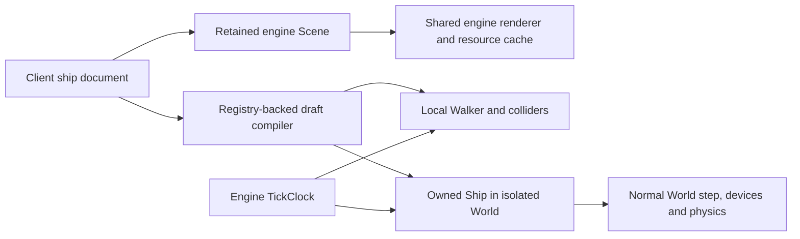

# Studio on the shared engine

Studio is a client document editor with retained engine scenes. DESIGN, its catalogue card, WALK, BALANCE and DRIVE submit the same installed PBR handles through `Frame::scene_view`. The renderer owns materials, alpha ordering, shadows, independent viewport depth, GPU preparation/upload budgets and cache residency. Model leases survive graph, frame and upload-worker lifetimes. Engine renderer changes therefore reach every Studio viewport.



The editor retains object IDs, placement, selection, layers, undo, YAML source and private deck documents. UI annotations and two-dimensional drafting remain client presentation, using the engine camera projection. Flat authoring views use `Projection::Orthographic`; module selection uses `Scene::pick`. Installed GLBs are never copied into a second face list or projected/sorted on the UI thread. Local structure and fallback envelopes are prepared once and promoted to installed models as the shared loader completes.

WALK owns its Walker, TickClock, collision meshes and Scene. Native hull collision and rendering share the imported hull's coordinate frame. Decks, authored rooms, equipment envelopes and moving hatch leaves are local colliders. Hatch meshes are retained; the normal proximity opening rule updates only their translation. WALK requests never move the live pilot or write the live vessel's interior.

DRIVE owns a minimal local World: one star index, an inert root marker, a nonrotating smooth laboratory planet, an owned Ship and the engine TickClock. It calls the normal `World::step_ship`; gravity, drag, rigid-body integration, ground contact, heat, resource consumption, manual/assisted controls and takeoff release have no Studio copies. The document compiler produces an owned uncommissioned ClassSpec and per-record fan, battery and landing-leg Fit. No authored draft is inserted into the playable hull catalogue. BALANCE is explicitly rated static allocator analysis; its full-load mass, COM, inertia and thrusters come from the same compiled ClassSpec when available.

Geometry preparation uses a revision-bound worker and an explicit cancelable preparation screen. Opening an empty Studio no longer imports/commissions MC-07. A selected native hull resolves its own physical prerequisite in the startup preparation worker. Editor sessions copy initial live decks once; edits, loaded documents and walk-throughs stay in that session. The old `Panels.preview`, `Command::Preview`, `Universe::preview` and global preview drawing bridge are removed.

## Physical limits

This is an uncommissioned laboratory, not a structural certification. Draft hull damage strength is explicitly unrated. Module collision uses authored equipment envelopes; neutral asset motion/handedness acceptance gates continue to apply. Shared landing rules use the supplied leg ratings, without a new individual spring simulation. The shared Ship currently has one fuel pool: incompatible mixtures and missing registry physical limits block DRIVE with a diagnostic rather than combining unlike resources. Non-propellant stored contents are fixed full-load payload for the trial. No network, economy population or procedural galaxy is created for a Studio flight.

A remaining previously documented model-to-design thrust-basis mismatch for some engine assets is outside this rebuild; this work does not retune saved poses or physics to disguise it. See `studio-installed-models.md` and the existing YAML integration evidence.

## Validation and use

Final checks and measured captures are recorded in `docs/diagnostics/studio-rebuild.json`. The detailed logs/images and diagnostic designs are under `out/review/studio-rebuild/` in the rebuild worktree. Existing saved files are copied into an isolated data directory for tests.

From the worktree root:

```sh
target/release/freefall-studio /path/to/design.ship.yaml
```

`Ctrl+E` edits YAML; `Ctrl+Enter` applies it. `Ctrl+T` opens BALANCE and Enter starts DRIVE. DRIVE uses the normal flight bindings: J powers engines, W/S sets forward throttle, Shift+E asks for upward translation, G changes manual/assisted control. WALK and DRIVE return to the document with Escape. F3 exposes the shared frame, asset and profiling HUD.
